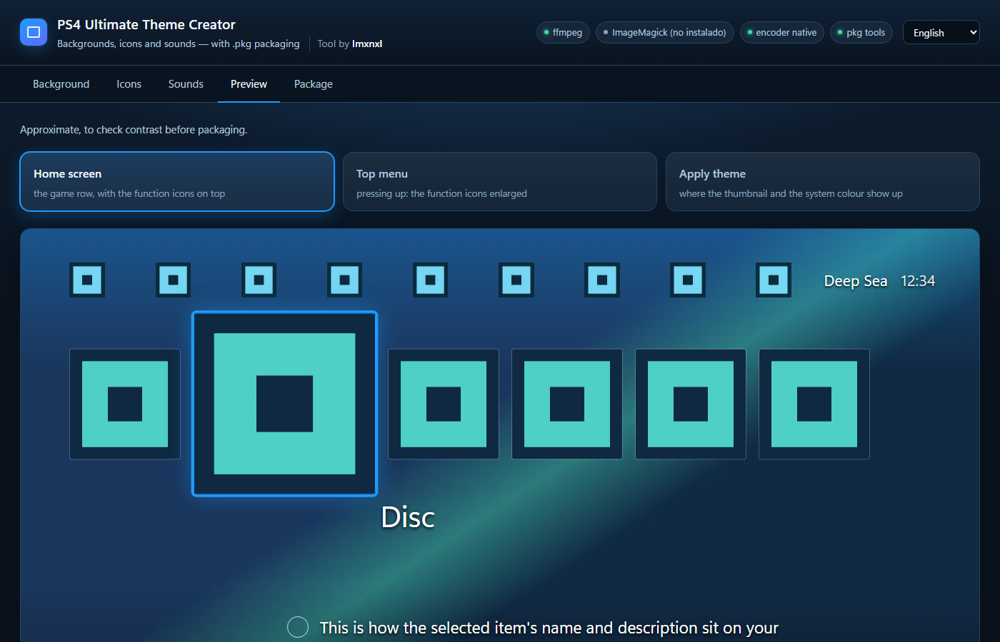
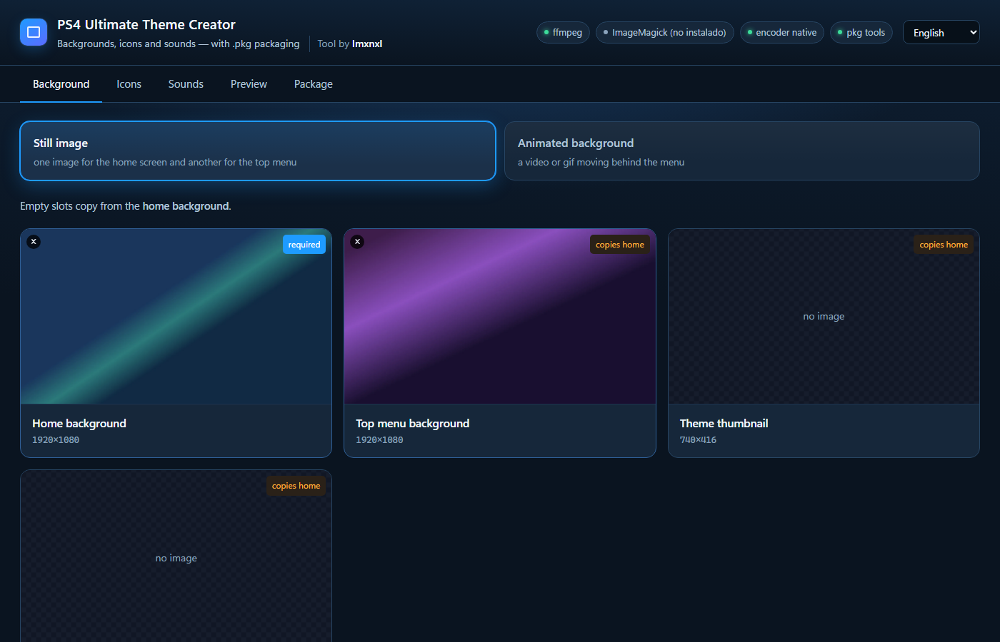
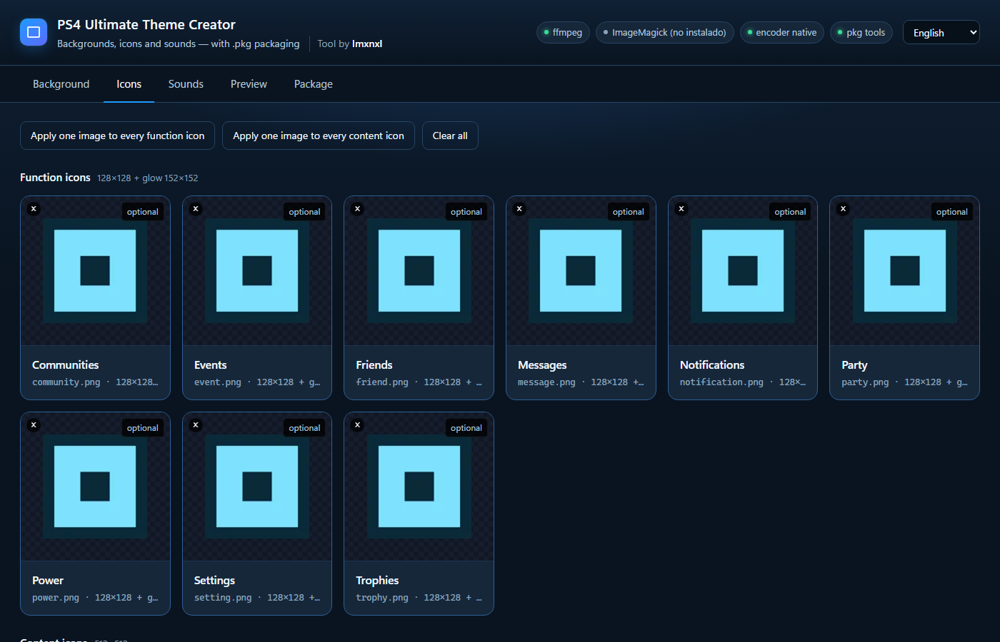
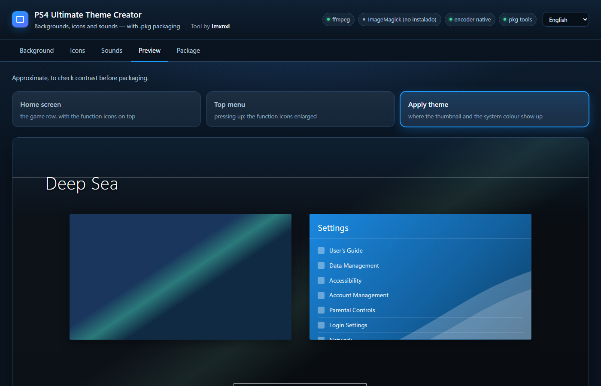
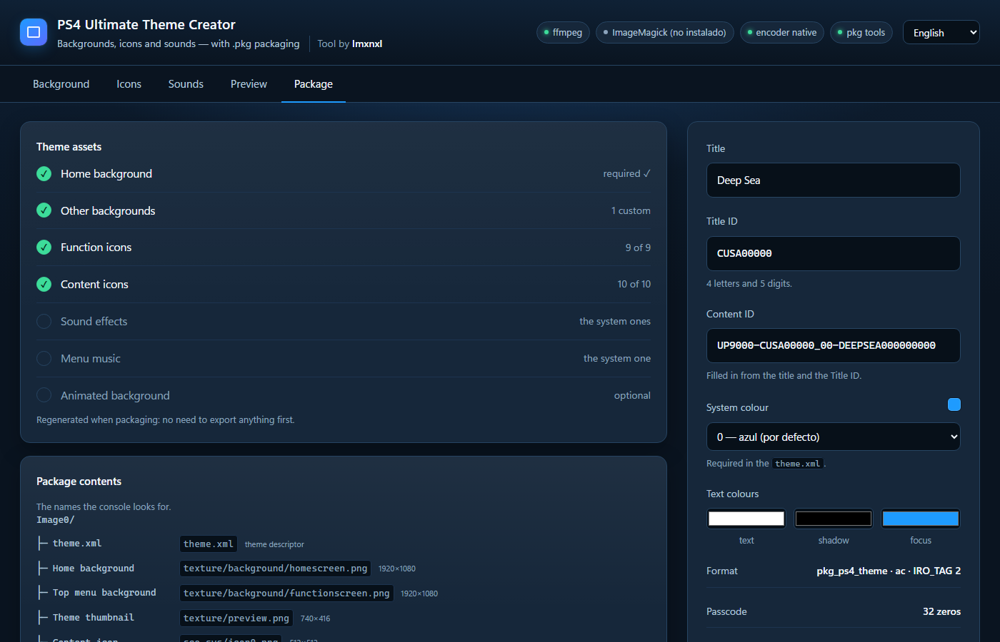

# PS4 Ultimate Theme Creator

Local web app that builds a custom PS4 theme — backgrounds, icons, animated
scene, music and sound effects — and packs it into an installable `.pkg`.

Everything runs in your browser against a server on your own machine. Nothing
is uploaded anywhere.

```powershell
.\run.ps1
```

Then open <http://127.0.0.1:8000>. The script installs the Python dependencies
if they are missing and starts the server. The interface is available in
English and Spanish.



---

## Requirements

| | |
|---|---|
| **Python 3.10+** | `run.ps1` installs `fastapi`, `uvicorn`, `python-multipart`, `numpy` |
| **ffmpeg** + **ffprobe** on PATH | decode the input video and audio |
| Windows | the packaging tools are 32-bit `.exe` |

ImageMagick is not needed — the DXT1a compressor is part of the project. If
`magick` is on PATH it is offered as an alternative backend.

### The packaging tools are not bundled

`orbis-pub-cmd.exe` and friends are **proprietary Sony binaries** patched by
the scene, so they are not redistributed here. You need **5 files**, and they
come from **two different downloads**.

#### 1. From "PS4 Fake PKG Tools 3.87 (Patched) V7" — 4 files

Good news: the layout inside that download is **already the one this project
wants**. Copy these four across, keeping the `ext/` subfolder, and you're done.

| Copy this file | To | Size | Without it |
|---|---|---|---|
| `orbis-pub-cmd.exe` | `tools/` | 3.12 MB | no packaging at all |
| `ext/sc.exe` | `tools/ext/` | 1.03 MB | `orbis-pub-cmd` won't even start |
| `ext/di.exe` | `tools/ext/` | 0.68 MB | same |
| `ext/libatrac9.dll` | `tools/ext/` | 0.11 MB | music loudness can't be measured |

The sizes are a rough check that you grabbed the right build. Nothing else
from that download is used — not the GUIs, not the validator, not the trophy
utilities, not the `PSX-PS2-FPKG` folder.

> That download also ships a second copy of `ext/` inside `PSX-PS2-FPKG/`.
> Either copy works; they are byte-identical.

#### 2. `at9tool.exe` — optional, 1 file

| Copy this file | To | Size | Without it |
|---|---|---|---|
| `at9tool.exe` | `tools/` | 0.21 MB | music must be uploaded already in `.at9`, and the volume control is disabled |

It is the "SCEI ATRAC9 TOOL" from Sony's SDK. It is *not* part of the Fake PKG
Tools download.

#### The end result

```
tools/
├─ orbis-pub-cmd.exe      ← required
├─ at9tool.exe            ← optional
├─ NOTICE.txt             (already in the repo)
└─ ext/
   ├─ sc.exe              ← required
   ├─ di.exe              ← required
   └─ libatrac9.dll       ← required
```

**The app runs without any of this.** On startup it checks what is present,
disables the *Package* tab if the tools are missing and carries on — you can
still build every asset and export the animated scene `.zip`. The status pills
in the top-right corner tell you what was detected.

See [tools/NOTICE.txt](tools/NOTICE.txt) for where these binaries come from.

---

## What it makes

| Tab | What it customises | Slots |
|---|---|---|
| Background | **still image** (home, top menu, thumbnail, icon) or **animated** (video/gif → RAF scene) | 4 |
| Icons | function (128×128 + 152×152 glow) and content (512×512) | 9 + 10 |
| Sounds | menu music → `.at9` · effects → `.vag` | 1 + 3 |
| Preview | mock-up of the console screens with your images | — |
| Package | puts it all into a `.pkg` | — |

**23 independent image slots.** The only required one is the **home
background**; every other background copies from it when left empty, and icons
you don't upload keep the system ones.





## How it works

**Still and animated backgrounds are mutually exclusive.** With a
`scene/background.raf/` present the console paints the scene on *both* screens,
so the two still PNGs are never visible — they are left out of the package. The
tab makes this an explicit choice: pick *animated* and the top-menu background
disappears, while the home one is renamed *theme image*, which is what it
actually does there (the list thumbnail, the icon and the store shot come from
it).

**Audio is converted for you.** Upload any format and it becomes what the
console expects. The music also has a **volume control**: a normal song lands
about 13 dB above the music of a real theme, so without levelling it drowns out
the rest of the system. The resulting level is declared in `param.sfo` as
`bgmhome_loud`, which is what the console uses to balance it.

**The preview** builds the three screens a theme touches — home, top menu and
the *apply theme* screen — using your images, icons and colours, so you can
check contrast without a package → USB → install round trip. Positions are
measured from real console captures.



**Work survives a page reload.** File ids are kept in the browser and checked
against `workspace/` on startup; whatever is still alive is restored.

Animated mode also exports a standalone `.zip` with the
`scene/background.raf/` folder, in case you'd rather assemble the theme by hand.

---

## Theme format

What the console produces from your assets:

```
Image0/
  theme.xml                              descriptor
  texture/
    background/homescreen.png            1920×1080  ┐ only when there is
    background/functionscreen.png        1920×1080  ┘ no animated scene
    preview.png                          740×416    list thumbnail
    function_icon/<name>.png             128×128
    function_icon/<name>_glow.png        152×152
    content_icon/<name>.png              512×512
  scene/background.raf/                  animated background (optional)
    NN.dds                               DXT1a
    plane.mdx                            shared plane
    index.xml                            scene
  sound/bgm_home.at9                     menu music (optional)
  sound/se_{decide,cursor,cancel}.vag    sound effects (optional)
Sc0/  param.sfo · icon0.png 512×512 · pic1.png   (placed by the tool)
```

Paths are not configurable — the console looks for those literal names.
Valid function icons: `community`, `event`, `friend`, `message`,
`notification`, `party`, `power`, `setting`, `trophy`.



### Rules you cannot break

All of these were verified on a real console. The app enforces them, so you
shouldn't be able to hit them from the interface — but if you touch the code,
they are what will bite.

| Rule | What happens otherwise |
|---|---|
| `volume_type=pkg_ps4_theme` + `IRO_TAG=2` + `CATEGORY=ac` | Without `IRO_TAG` it installs as an app with a *Start* button and throws **CE-37695-0**. With `CATEGORY=gd` it shows up in *Themes* but the console crashes (**CE-36329-3**) |
| `theme.xml` at the root, with `format-version` and `themecolor` | the console crashes when applying the theme |
| `background.raf/`: **≤ 6 MiB** of `.dds` **and** **≤ 48 frames** | installs fine, then fails to apply with **CE-38196-7** "data corrupted" |
| The scene's `wait` is in **seconds with decimals** | `wait="2"` is 2 seconds per frame, not 200 ms |
| The `.at9` is **144 kbps** with a loop (`-wholeloop`) | at 168 kbps and without an `smpl` chunk it stays silent, even though ffmpeg reads it fine |
| `<homebgm-enable>` only `True` when `sound/bgm_home.at9` exists | `True` without music makes the console play its own |
| Passcode of 32 zeros | it encrypts the package and is **not stored inside it**, so the installer has to know it up front |

Two more traps worth knowing: `gdt` is **not** a valid category despite what
some tutorials say, and the RAF scene has **no `target=` attribute** — the
`<case wait target>` you'll find online is made up.

Because of the frame and weight caps, the resolution you pick decides how long
the animation can be: **13** frames at 1280×720, **24** at 960×540, **48** at
640×360. DXT1 is fixed-rate, so the weight does not depend on the image.

---

## Development

```
app/
  config.py     format constants, limits and theme paths
  dxt1.py       DXT1a (BC1) encoder/decoder in numpy + .dds header
  dds.py        compression backends (native / ImageMagick)
  media.py      ffmpeg and ffprobe wrappers
  mdx.py        .mdx model (XDM format): parse, build, plane generator
  raf.py        animated scene (index.xml)
  vag.py        VAG (PS-ADPCM) encoder for the sound effects
  at9.py        ATRAC9 conversion via at9tool (optional)
  theme_xml.py  the theme.xml
  theme.py      frame names, LF-forced writing, .zip assembly
  pkg.py        packaging: param.sfo, keystone, .gp4, img_create
  jobs.py       working folders under workspace/
  main.py       API and server
  static/       interface (html, css, js — no bundler, no build step)
tests/          10 suites + make_fixtures.py
tools/          drop the packaging binaries here (not included)
workspace/      uploads and outputs, temporary — cleans itself
```

The frontend has no build step: edit `app/static/*` and reload.

### Tests

They need the server running on port 8000, and the browser ones need
playwright.

```powershell
python -m playwright install chromium    # only for test_ui*
python tests\make_fixtures.py            # sample.mp4 / .png / .at9 ... via ffmpeg
$env:PYTHONIOENCODING = "utf-8"

python tests\test_dxt1.py                # DXT1a encoder
python tests\test_http.py                # animated background API
python tests\test_slots.py               # slots and package tree
python tests\test_theme.py               # param.sfo read from inside the .pkg
python tests\test_pkg.py                 # packaging validation
python tests\test_audio.py               # music and effects
python tests\test_convert.py             # standalone converter
python tests\test_ui.py                  # browser: player and sliders
python tests\test_ui_slots.py            # browser: slot grids and packaging
python tests\test_ui_preview.py          # browser: console mock-up and session
```

Each suite prints `OK`/`FAIL` per line and exits 1 if anything failed. The ones
that build a `.pkg` need the tools in `tools/`.

---

## Licence and credits

The code in this repository is MIT — see [LICENSE](LICENSE). That does **not**
cover the packaging binaries, which are proprietary Sony software and are not
distributed here.

Tool by [Imxnxl](https://github.com/Imxnxl).
